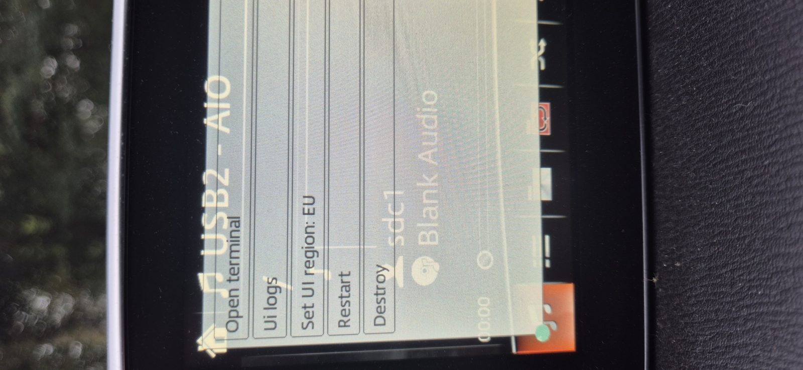
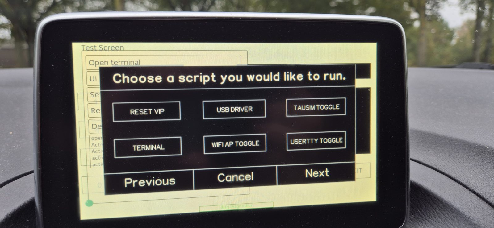

# Getting root on the CMU first (this toolkit does NOT do that)

**This toolkit assumes you already have root + USB autorun on the CMU.**
Since firmware **v59.00.502** Mazda patched the USB autorun, so on a stock
v59.00.502 you must re-enable it first. Two proven methods:

## Method A — MP3/XSS workaround (mzd-connect-1-root, works on v59.00.502)

The classic [mzd-connect-1-root](https://github.com/mzd-evo/mzd-connect-1-root)
chain uses an **ID3v2 TIT2 tag XSS** in MP3 files to run privileged JS inside
the Opera GUI (`utility.loadScript(...)` → `sendEventToMmui`), which then
installs the ID7 autorun hook.

### USB stick layout for the root step (NOT this toolkit — the root files)

```
USB-root/
├── mp3/
│   ├── a.mp3     # TIT2 = </span><iframe onload="utility.loadScript('../../../mnt/sda1/js/run.js')"></iframe><span>
│   ├── b.mp3     # same, but sdb1
│   ├── c.mp3     # same, but sdc1
│   └── d.mp3     # same, but sdd1   (covers whichever slot the stick gets)
├── mp3title.txt  # same XSS payload as a plain text title
├── js/run.js     # privileged payload (sendEventToMmui → install autorun)
├── css/init.css
├── dev.html
├── run.sh
└── id7/
    └── autorun   # NOTE: no .sh extension — copied to /data_persist/dev/bin/autorun
```

### Steps on the car

1. Put the stick in, start the car, **open the Music app and play one of the
   MP3s** (or browse to the folder so the title renders). The XSS fires and
   `run.js` installs `/data_persist/dev/bin/autorun` + hooks
   `stage_wifi.sh` / `stage_1.sh`.
2. Reboot. On boot the autorun hook now runs — root persistence is in place.
3. Verify: `ls /data_persist/dev/bin/autorun` and check
   `/jci/scripts/stage_wifi.sh` contains the autorun hook line.

> Keep LF line endings in `run.sh` / `id7/autorun` (Windows editors can inject
> CRLF — that breaks them). FAT32 only, MBR partition table.

## Method B — Diagnostic menu → JCI Test Mode (all firmwares)

1. Hold **Music + Nav + Mute** together for ~3 seconds until the **Diagnostic
   Menu** appears (left photo).
2. In that menu, hold **DEL** for 15–20 seconds until **"JCI Test Mode Active"**
   shows — this is the "Test Screen" with *"Choose a script you would like to
   run."* (right photo: RESET VIP, USB DRIVER, TAUSIM TOGGLE, **TERMINAL**,
   WIFI AP TOGGLE, USERTTY TOGGLE).
3. From there you can run scripts / enable the autorun path (this is how
   AIO-TI installs its tweaks on v59).




## Method C — UART serial (all firmwares, 115200 baud)

TX/RX/GND on the back of the CMU → serial console as root. Most reliable but
requires opening the unit.

## After root: install THIS toolkit

Once autorun works, see [INSTALL.md](INSTALL.md). The toolkit's `install.sh`
**extends** the existing autorun hook — it does not create it from scratch.

For the on-screen terminal and menu/UI switching after install, see the
"Terminal shortcut & switching menu/UI" section in [README.md](../README.md)
and "Switching between the terminal menu and the normal UI" in
[INSTALL.md](INSTALL.md) - System & security menu options 4 (start terminal,
diag code 22), 5 (close terminal / back to UI), 6 (permanent Terminal entry
in Settings -> System, patch + reboot).

## Notes for the CMU terminal (no Shift key)

The on-screen terminal has **no Shift key**, so `*` and other shifted
characters can't be typed directly. Use globbing instead:

```sh
cd /data*p*        # expands to /data_persist
cd /tmp/mnt/sd*    # expands to /tmp/mnt/sda1 (or sdb1, ...)
```

The toolkit menu itself is **numeric-only** for the same reason — you type a
number, not a letter.

---

# Root access per firmware version (research 2026-11)

The methods above (MP3/XSS, diagnostic menu, UART) are the classic ones. The
table below summarizes what the stock firmware itself offers per version, based
on a live v59.00.502A EU N unit **verified on real hardware** and a v74 rootfs
image **analyzed offline** (file-level strings/hexdump; not booted). Items are
marked **[verified]** (live unit) or **[reported]** (image analysis / community
reports, not independently confirmed).

## 1. Version matrix

| Firmware | sshd in stock rootfs | Root route | Notes |
|---|---|---|---|
| v30-v55 | no | serial console exploit or USB autorun (if present) | no sshd binary in rootfs; tweaks need manual install |
| v55-v59 | **yes** | SSH on port **36000**, pubkey-only via `/config-mfg/authorized_keys`, login user `cmu` is **uid 0** | stock `sshd_config`: `PermitRootLogin yes`, `PasswordAuthentication no` |
| v70+ | yes | same as v59; sshd_config unchanged | single-file `.up` (no separate failsafe.up) |
| v74 | yes | same as v59; sshd_config **byte-identical** to v59 **[verified by image diff]** | `jci-autorun` USB hook string confirmed in the v74 binary @ `0xa962ad0` **[reported]** |

Proof that v59 and v74 sshd configs are identical: the rootfs diff found
`sshd_config` byte-identical in both images (see FIRMWARE.md section 3).

## 2. What survives a firmware update

| Component | Location | Survives a `.up` update? | Note |
|---|---|---|---|
| `/config-mfg` (authorized_keys, passwd, wl1271-nvs.bin, fgsn.dat) | NOR flash `mtdblock5` (read-only) | **yes** - never overwritten by `.up` | SSH keys keep working after every update |
| `sshd_config` (`/etc/ssh/`) | rootfs `/dev/ffx01p1` | identical in v59 and v74 | port 36000, PermitRootLogin yes, key-only |
| `cmu` user (uid 0) | `/etc/passwd` in rootfs | present in both | `cmu:...:0:0:root:/root:/bin/sh` |
| `/data_persist` (autorun, toolkit, keys) | eMMC `/dev/mmcblk0p2` | **update.up: yes** / **reinstall.up: may be wiped** | a `.up` can contain `cleandatapersist/` -> wipes `/mnt/data_persist/` |
| NOR fail-safe image | SPI-NOR `mtd` "fail-safe" | only via explicit `fail-safe/` dir in a `.up` | not in the eMMC backup |
| VFBL bootloader | SPI-NOR @ 0x10000 | only via `bootstrap/` dir in a `.up` | not in the eMMC backup |

**Practical consequence:** after any firmware update (e.g. v59 -> v74), SSH
root on port 36000 keeps working automatically as long as
`/config-mfg/authorized_keys` is intact (it lives in NOR flash and is never
overwritten). After a `reinstall.up`, `/data_persist` may be wiped
(`cleandatapersist/`) - redeploy the autorun/toolkit via the `jci-autorun` USB
hook or manually over SSH. After an incremental `update.up`, `/data_persist`
is preserved.

## 3. The `.up` package format

A Mazda `.up` file is a **password-protected ZIP plus a 256-byte SHA256
signature appended as the last 256 bytes** **[reported, from community
analysis of update packages]**:

| Part | Description |
|---|---|
| ZIP password | `5X/9vAVhovyU2ygK` (widely known in the community) - allows opening the ZIP for analysis |
| Signature | last 256 bytes = SHA256, verified against `publisher_cert.pem` |
| Cert chain | `jci_root_cert.pem` (in rootfs `/jci/certificates/`) -> `jci_subord_cert.pem` -> `publisher_cert.pem` (both in the ZIP) |
| Verification steps | 1. root cert integrity -> 2. subord vs root -> 3. publisher vs subord -> 4. signature vs publisher |

ZIP contents (driven by `main_instructions.ini`):

| Dir/File | Required | Function |
|---|---|---|
| `main_instructions.ini` | yes | `[Settings]`/`[Instructions]`/`[DataStorage]` - operations: Execute, ImageUpdate, FileUpdate |
| `jci_subord_cert.pem`, `publisher_cert.pem` | yes | update certificates |
| `versions.ini.gz` | optional | version compatibility |
| `rootfs1upd/`, `linux1/` | optional | rootfs / main kernel update (ImageUpdate) |
| `bootstrap/`, `ibc1/`, `ibc2/`, `fail-safe/` | optional | SPI-NOR updates |
| `vip/`, `gps/` | optional | VIP coprocessor / GPS firmware |
| `passwdupdate/` | optional | scripts to update `/etc/passwd` and `authorized_keys` |
| `cleandatapersist/` | optional | **wipes `/mnt/data_persist/`** - autorun/toolkit-v59/keys are lost on reinstall |
| `usersettingsbackup/` / `usersettingscleanup/` / `usersettingsrestore/` | optional | user settings backup/restore during update |
| `resources/`, `preloaddata/`, `compactwnn/`, `getnewflavour/`, `checksumoption/` | optional | misc |

**Can you modify a `.up`? No.** The 256-byte signature is verified through the
4-step certificate chain; without Mazda's private signing keys a modified `.up`
cannot be re-signed and the CMU refuses unsigned packages. Opening the ZIP
with the known password for analysis is fine; repacking without a valid
signature is rejected.

**Region lock:** firmware is region-locked via SKU files
(`/jci_mazda/sku_na.ini`, `sku_eu.ini`, ... - new in v74) and
`JCI_SW_FLAVOR` in the version data (`NA` for NA builds). Flashing a NA `.up`
on an EU unit is rejected or bricks the unit - always use the `.up` matching
your car's region.

## 4. Serial console (UART) per version

| Firmware | Login | Result | Note |
|---|---|---|---|
| v59 **[verified live, 2026-11-17]** | **`cmu` / `mzd`** (factory default, uid 0, shell `/bin/sh`) | **working root shell** | used to recover a bootlooping unit, see [RECOVERY-BRICK.md](RECOVERY-BRICK.md) |
| v59 **[verified live]** | `user` / `jci` | login accepted, but the session closes immediately | shell `/bin/shsshd` in passwd does not exist as a binary |
| v74 **[reported, image analysis]** | `cmu` entry with uid 0 and `/bin/sh` is present in the image | expected to work as on v59, not yet tested live | - |

**Conclusion:** the serial console *is* a working root route on v59 when you
log in as `cmu` / `mzd`. Earlier reports of "serial is a dead end" came from
trying the wrong account/password (`root`/`cmu`, `cmu`/`jci`) or the `user`
account with its broken shell. The `cmu`/`mzd` credentials are factory
defaults identical on every unit. A 3.3V USB-UART adapter is required
(115200 8N1); the login prompt appears roughly 7 s after power-on.

## 5. USB autorun hook (`jci-autorun`)

- `updatea_sys_srv` scans a mounted USB partition for a file named
  **`jci-autorun`** in the root of the partition.
- If found: `system("(cd <mountdir> && jci-autorun) &")` - executed as **root
  without login**.
- The string `jci-autorun` at `0xa962ad0` in the v74 binary - confirmed present
  **[reported]**.
- Observed live at t ~7.7 s during boot (before a watchdog crash at ~10 s)
  **[verified]**.
- This is the primary "root without SSH" route during/after firmware updates.
- Related: the stock rootfs also contains `start_eth1_dhcp.sh` (v74), so eth1
  support is built into the firmware itself **[reported]**.

## 6. Backup vs `.up` - why a raw backup is not flashable

| | Raw backup (dd of block device) | `.up` file |
|---|---|---|
| Format | MAST container (raw block device) | password-protected ZIP + SHA256 signature |
| Signed | no | yes - cert chain root -> subord -> publisher |
| Flashable via REFLASH | **no** - not a `.up` container | yes |
| Usable for | analysis, file-level restore, diff | official firmware update / recovery |
| Restoring a raw `dd` | **high brick risk** (no A/B switch, no rollback) | n/a |

A modified `.up` cannot be made "standard root + eth1 SSH" - signing makes
that impossible. Instead use `jci-autorun` on USB plus
`/data_persist/dev/bin/autorun` to configure eth1 and sshd automatically after
every boot.
