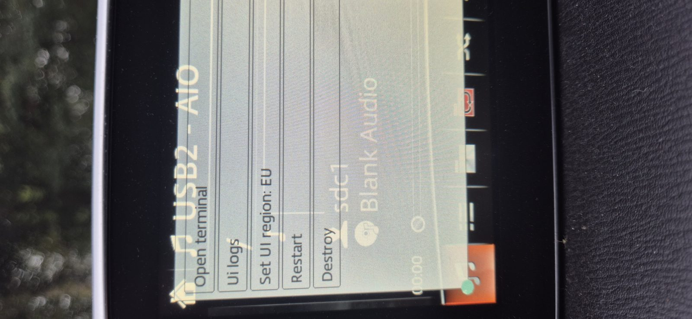
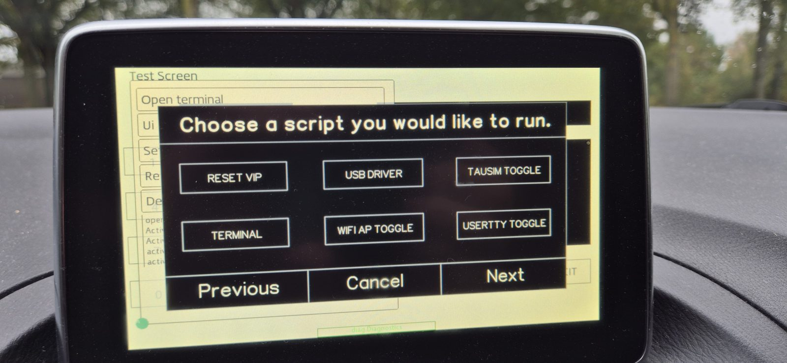

# Getting root on the CMU first (this toolkit does NOT do that)

**This toolkit assumes you already have root + USB autorun on the CMU.**
Since firmware **v59.00.502** Mazda patched the USB autorun, so on a stock
v59.00.502 you must re-enable it first. Two proven methods:

## Method A — MP3/XSS workaround (mzd-connect-1-root, works on v59.00.502)

The classic [mzd-connect-1-root](https://github.com/mzd-evo/mzd-connect-1-root)
chain uses an **ID3v2 TIT2 tag XSS** in MP3 files to run privileged JS inside
the Opera GUI (`utility.loadScript(...)` → `sendEventToMmui`), which then
installs the ID7 autorun hook.

### USB stick layout for the root step (NOT this toolkit — the root files)

```
USB-root/
├── mp3/
│   ├── a.mp3     # TIT2 = </span><iframe onload="utility.loadScript('../../../mnt/sda1/js/run.js')"></iframe><span>
│   ├── b.mp3     # same, but sdb1
│   ├── c.mp3     # same, but sdc1
│   └── d.mp3     # same, but sdd1   (covers whichever slot the stick gets)
├── mp3title.txt  # same XSS payload as a plain text title
├── js/run.js     # privileged payload (sendEventToMmui → install autorun)
├── css/init.css
├── dev.html
├── run.sh
└── id7/
    └── autorun   # NOTE: no .sh extension — copied to /data_persist/dev/bin/autorun
```

### Steps on the car

1. Put the stick in, start the car, **open the Music app and play one of the
   MP3s** (or browse to the folder so the title renders). The XSS fires and
   `run.js` installs `/data_persist/dev/bin/autorun` + hooks
   `stage_wifi.sh` / `stage_1.sh`.
2. Reboot. On boot the autorun hook now runs — root persistence is in place.
3. Verify: `ls /data_persist/dev/bin/autorun` and check
   `/jci/scripts/stage_wifi.sh` contains the autorun hook line.

> Keep LF line endings in `run.sh` / `id7/autorun` (Windows editors can inject
> CRLF — that breaks them). FAT32 only, MBR partition table.

## Method B — Diagnostic menu → JCI Test Mode (all firmwares)

1. Hold **Music + Nav + Mute** together for ~3 seconds until the **Diagnostic
   Menu** appears (left photo).
2. In that menu, hold **DEL** for 15–20 seconds until **"JCI Test Mode Active"**
   shows — this is the "Test Screen" with *"Choose a script you would like to
   run."* (right photo: RESET VIP, USB DRIVER, TAUSIM TOGGLE, **TERMINAL**,
   WIFI AP TOGGLE, USERTTY TOGGLE).
3. From there you can run scripts / enable the autorun path (this is how
   AIO-TI installs its tweaks on v59).




## Method C — UART serial (all firmwares, 115200 baud)

TX/RX/GND on the back of the CMU → serial console as root. Most reliable but
requires opening the unit.

## After root: install THIS toolkit

Once autorun works, see [INSTALL.md](INSTALL.md). The toolkit's `install.sh`
**extends** the existing autorun hook — it does not create it from scratch.

## Notes for the CMU terminal (no Shift key)

The on-screen terminal has **no Shift key**, so `*` and other shifted
characters can't be typed directly. Use globbing instead:

```sh
cd /data*p*        # expands to /data_persist
cd /tmp/mnt/sd*    # expands to /tmp/mnt/sda1 (or sdb1, ...)
```

The toolkit menu itself is **numeric-only** for the same reason — you type a
number, not a letter.
