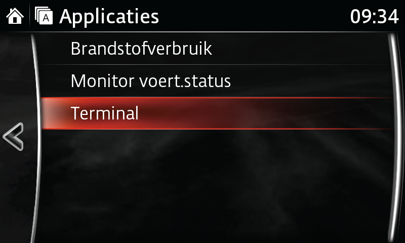

# Terminal in Applications + shorter startup disclaimer (v74) - permanent, RAM-only

Adds a **Terminal** item to *Applications* on firmware **v74.00.324**. Selecting it opens the
on-screen terminal. Verified on real hardware (item present after a real reboot, opens the terminal,
`exit` returns to the GUI).



## How it works

- `gui-early.sh` runs at boot (started in the background by the AA kit's `aa-early.sh`, ~10 s after
  power-on, before Opera starts). It copies `systemApp.js.patched` to `/tmp` and **bind-mounts** it over
  `/jci/gui/apps/system/js/systemApp.js`. The rootfs is never written; after an uninstall or a
  `DISABLE`, the next boot is stock.
- The patched `systemApp.js` adds the item `Terminal` to the Applications list. Selecting it opens a
  WebSocket to `127.0.0.1:9997`; a busybox `inetd` there runs `mzd-terminal-trigger.sh`, which starts
  the terminal (`systemHooks.sh 22`) or brings it to the front if it already runs.
- The item is **greyed out while driving** (it is in the speed-restricted list, plus a speed check in
  the click handler). Driving behaviour is not tested yet.
- The same patch also shortens the **startup disclaimer** (the warning screen after power-on): its
  timer goes from 3500 ms to 0 (retry 3500 -> 500 ms; 0 there would busy-loop). Measured after a real
  reboot: the disclaimer is on screen ~1 s instead of >= 3.5 s. It cannot be made fully invisible from
  the GUI side, because the MMUI shows that screen itself.
- Safety: md5 checks of the stock and patched file, a crash counter (3 failed boots -> `DISABLE`,
  i.e. stock), "proven" after 3 healthy boots. Always fails open (stock).

## Install

1. On the PC, build the patched file from **your own** stock file (this repo ships no Mazda files):
   ```sh
   scp -P 2222 cmu@<CMU_IP>:/jci/gui/apps/system/js/systemApp.js .
   python3 make-patched-systemapp.py systemApp.js        # -> systemApp.js.patched (md5-checked)
   ```
2. Copy this folder (now including `systemApp.js.patched`) to the CMU and install (writes only to
   `/data_persist`):
   ```sh
   scp -P 2222 -r . cmu@<CMU_IP>:/data_persist/terminal-kit
   ssh -p 2222 cmu@<CMU_IP> 'sh /data_persist/terminal-kit/install-terminal.sh'
   ```
3. Reboot (Mute+Navi 10 s). *Applications -> Terminal* is there.

**Requires the boot hook of the Android Auto kit** (`../aa`, `aa-early.sh` with the `gui-early` line).
Without the AA kit nothing starts `gui-early.sh` at boot.

## Use

- Open: *Applications -> Terminal*, or toolkit menu *System & security -> 4*.
- Close: type `exit` (USB keyboard), or toolkit menu option 5 / `tools/ui.sh close`.
- Note: keys typed in the terminal also reach the GUI behind it (the menu behind it may move).

## Status / disable

```sh
sh /data_persist/dev/gui/gui-status.sh            # mount, DISABLE, counter, inetd, last log lines
sh /data_persist/dev/gui/gui-status.sh disable    # next boot stock
sh /data_persist/dev/gui/gui-status.sh enable
```

## Warning

Do not restart the GUI (Opera) twice in quick succession to test changes: on v74 that caused a black
screen and a board reset once. Plan a normal reboot instead.

The scripts are shipped unchanged from the hardware-tested version, so their comments and log
messages are in Dutch.
