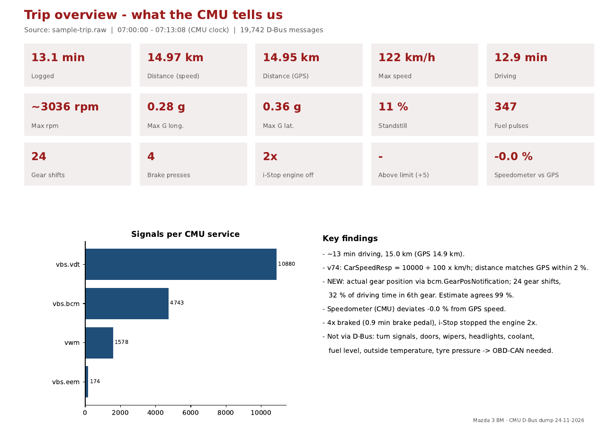
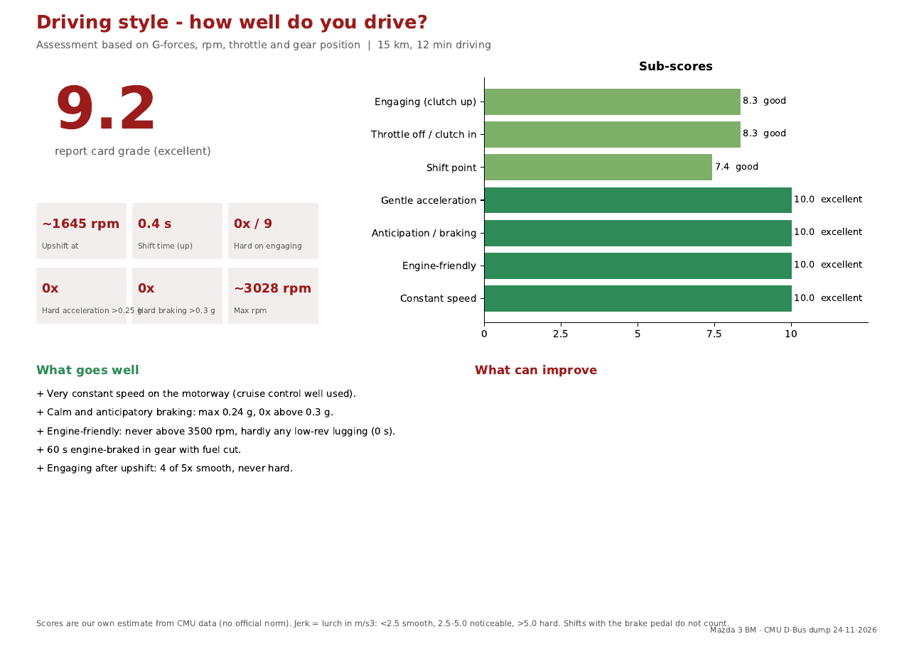
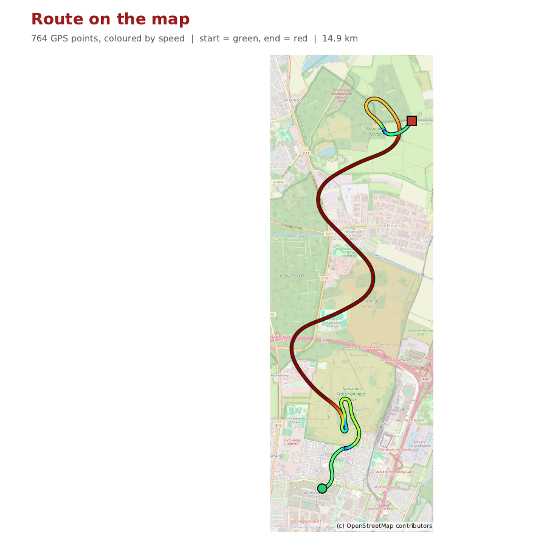

# Trip analysis tools

## Sample report (synthetic data - no real trip)

So you can see what the report looks like without a car, the repo ships a
full **14-page sample PDF** rendered from a procedurally generated capture.
Everything in it is invented: the route is dead-reckoned over a generic public
area and contains **no real GPS or personal data**.

| Summary page | Driving style | Route page |
|---|---|---|
|  |  |  |

Full PDF: [`sample/sample-overview.pdf`](sample/sample-overview.pdf). Regenerate it
with:

```sh
python3 make_sample_capture.py sample-trip.raw     # synthetic dbus-monitor .raw
python3 make_overview_pdf.py sample-trip.raw sample-overview.pdf
```

`make_sample_capture.py` is a demo generator only - it is never needed to
analyze a real capture.

Analyze a raw `dbus-monitor` capture from the Mazda CMU service bus
(`unix:path=/tmp/dbus_service_socket`). See `docs/VEHICLE-DATA-DBUS.md` for
the signal list, the corrected scale factors and what is *not* available on
D-Bus (gear position, turn signals, doors, ... - those need an OBD CAN
adapter).

## Capturing on the CMU

Install `toolkit-v59/tools/autolog.sh` on the CMU (e.g. as
`/data_persist/dev/bin/mzd-dbus-autolog.sh`, started from
`/data_persist/dev/bin/autorun`). It writes one pair of files per boot to a
USB stick:

```
<usb>/dbus-logs/dbus-b<bootid>-u<uptime>.raw    full dbus-monitor output
<usb>/dbus-logs/dbus-b<bootid>-u<uptime>.meta   START/STOP + heartbeats
```

Or capture manually:

```sh
dbus-monitor --address="unix:path=/tmp/dbus_service_socket" > /tmp/mnt/sdX1/dump.raw
```

## Analyzing on a PC

All paths are command-line arguments; nothing is hardcoded.

```sh
python3 parse_dbus.py   <dump.raw> [events.csv]   # events + per-signal stats
python3 analyze_trip.py <dump.raw>                # text stats + ASCII charts
python3 make_overview_pdf.py <dump.raw> <out.pdf> # 14-page PDF overview
```

Notes:

- Run `make_overview_pdf.py` with plain `python3`, **not** `python3 -I`:
  numpy/matplotlib live in the user site-packages. Requires numpy and
  matplotlib. For the route page (`osm_map.py`) it also needs `requests` and
  `Pillow`; without them the PDF is still produced, just without the OSM map.
- `osm_map.py` draws an OpenStreetMap background behind the GPS route and also
  writes a standalone Leaflet map `<out>-map.html`. OSM tiles are fetched once
  and cached under `~/.cache/osm-tiles/`.
- `make_overview_pdf.py` prints a control line at the end:
  `OK <file> dur=... dist=... gps=... ...`. `dist` (integrated speed) and
  `gps` (haversine over the GPS fixes) should agree within ~15 %; if not, a
  scale factor is wrong.
- The PDF has up to 14 pages: summary, timeline, shift behavior, **driving
  style score + shift quality** (`driving_style.py`, needs v74
  `bcm.GearPosNotification`), driving dynamics, wheel speeds, speed vs. limit,
  engine / i-Stop / brakes, OSM route map, route + warnings, data inventory.
  Sections whose signals are missing are skipped.
- `driving_style.py` scores a trip 0-10 from shift jerk (clutch in / engaging),
  shift rpm, acceleration, braking, engine-friendliness and speed constancy.
  Shifts are detected as `gear -> 0 -> gear'` (0 = clutch pressed); shifts with
  the brake pedal pressed are excluded. The scale is our own, not an official norm.
- `CarSpeedResp` has a different standstill offset on v59 (2500) and v74
  (10000); `make_overview_pdf.py` auto-detects it from the floor value and
  prints which it used on the data-inventory page. See `docs/VEHICLE-DATA-DBUS.md`.
- Gear labels use `rpm / km/h` ratios from a dedicated 1..6 calibration drive
  (~113/59/40/31/25/20); these are mechanical and the same on v59 and v74.

## PRIVACY

A raw capture contains **GPS coordinates and timestamps of real trips**.
Treat it as personal data: never commit or publish `.raw` files, the
`<out>-map.html` Leaflet map, or page 5 (route) of the PDF - all three contain
the real route. Strip the route page and delete the `-map.html` before sharing.

## Corrected scale factors (do not reuse the old ones)

| Signal | Conversion |
|---|---|
| `bcm.CarSpeedResp` (uint32) | firmware-dependent: v59 `(v-2500)/25`, v74 `(v-10000)/100` km/h (auto-detected) |
| `vdt.Veh_V_ActlEng` (uint16) | `v/100` = km/h (only sent while driving) |
| `vdt.EngAout_N_Actl` (uint16) | `v*2` = rpm (estimated) |
| `vdt.VehLong_A_Actl` / `vdt.Lateral_Acceleration` | `(v-4000)/100` = m/s^2 |
| `vdt.SteWhlComp_An_Est` | `(v-16384)/128` = degrees |
| `vdt.ApedPos_Pc_ActlArb` | `v/10` = % |
| `vdt.FuelPulse` (byte) | cumulative counter, wraps at 256 |
| `vdt.GlobalRealTime` | unit = **0.1 s** (not seconds, not unix) |
| `com.jci.time` `GetDatetime` return | unix epoch - use as time axis |
| `lds.data` `GetPosition` return | `int32, uint64, double lat, double lon` |
